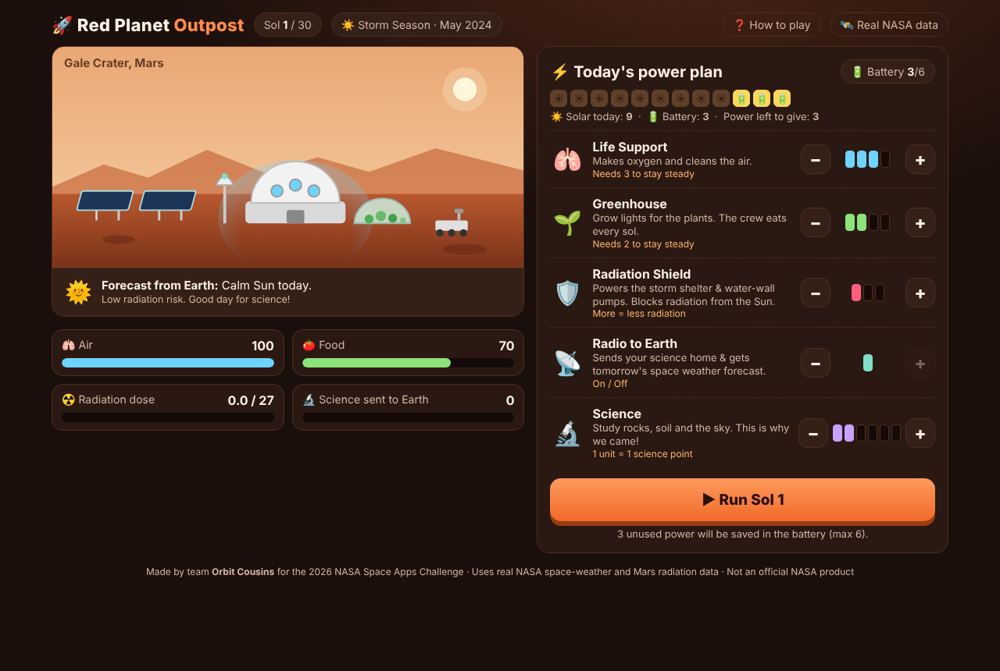
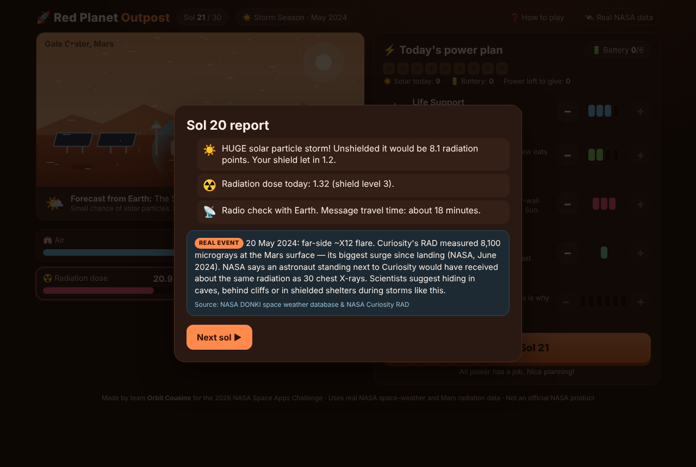
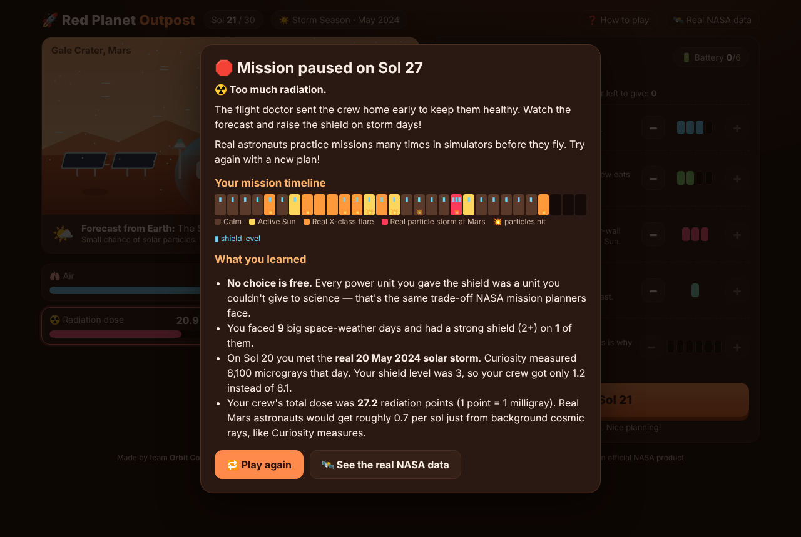

# 🚀 Red Planet Outpost: 30-Sol Mission

**Team Orbit Cousins · 2026 NASA Space Apps Challenge · Challenge: _Build a Junior Astronaut Mission Trainer_**

A browser game for kids aged 7–12. The player runs a small Mars outpost for 30 sols (Mars days), splitting a limited supply of solar power between air, food, a radiation shield, a radio link to Earth and science. The solar storms in the game are **real events from NASA's space-weather records**. That includes the storm of 20 May 2024, when NASA's Curiosity rover measured its biggest radiation surge ever on the surface of Mars.

▶ **Play:** https://atheeralgh1990.github.io/red-planet-outpost/ (no download, no account)

🎬 **Demo video (30 s, English captions):** [docs/demo.mp4](docs/demo.mp4)

🌐 **Bilingual: English and العربية.** Switch at any time with the language button. The Arabic version uses a full right-to-left layout and translates everything, including decision cards, NASA facts and real-event descriptions.

> **بالعربية:** «محطة الكوكب الأحمر» لعبة متصفح للأطفال من 7 إلى 12 سنة. يدير اللاعب قاعدة على المريخ لمدة 30 سول (يومًا مريخيًا)، ويوزّع طاقة شمسية محدودة بين الهواء والطعام ودرع الإشعاع والراديو والعلوم. العواصف الشمسية في اللعبة أحداث حقيقية من سجلات ناسا لطقس الفضاء.

---

## The problem

Space content for kids tends to be one of two things. Either it's posters and facts with no real decisions, or it's too technical to hold a young learner's attention. Kids rarely get to *feel* the trade-offs that decide whether a mission succeeds or fails.

## Our solution: every power unit has a cost

Each sol, the solar panels make **9 power units**, or only **5 during a dust storm**. A battery stores up to 6 leftover units. The player gives every unit a job:

| System | What it does | The trade-off |
|---|---|---|
| 🫁 Life Support | Makes oxygen | Needs 3 every sol or the air runs down |
| 🌱 Greenhouse | Grows food | Needs 2 every sol or the food runs down |
| 🛡️ Radiation Shield | Storm shelter and water-wall pumps | Each unit blocks radiation but takes power from science |
| 📡 Radio to Earth | Sends science home and brings tomorrow's space-weather forecast | Costs power. Without it, storms arrive by surprise and science never reaches Earth |
| 🔬 Science | The reason the crew is on Mars | Only what reaches Earth counts toward the score |

The player **wins** by surviving all 30 sols with air and food above zero and the radiation dose under the safety budget. Stars reward science sent to Earth.

There is **no free safe choice.** We simulated 200 missions per strategy (`tools/balance_sim.py`):

| Strategy | Survival rate | Science |
|---|---|---|
| Never shield | 0% (crew sent home around sol 19) | – |
| Low shield every sol | ~39% | high |
| Read the forecast, shield up on storm days | ~95% | ~41 ⭐⭐⭐ |
| Medium shield every sol | ~95% | ~29 ⭐⭐ |

**Why the real data matters:** keeping the shield on medium every sol is just as safe as reading the forecast, but it wastes power. Players who read the real space-weather forecast and shield up only on storm days send home **about 40% more science (41 vs 29) at the same safety**. That's exactly what NASA mission planners do: watch the space weather and protect the crew when it matters, so there's power left for the mission.

## How we answer the challenge

| What the challenge asks for | How Red Planet Outpost does it |
|---|---|
| Kids aged 7–12 run a lunar or Martian outpost | 30-sol Mars outpost in Gale Crater, plain language, big buttons, a talking scientist (Dr. Rana) who reads explanations aloud, English and Arabic |
| **Life support** | Needs 3 power every sol or the air runs down; water-recycler and air-scrubber decisions |
| **Radiation shielding** | Shield level 0–3 cuts the dose; real solar storms from NASA DONKI; real Curiosity RAD dose of 8,100 µGy on 20 May 2024 |
| **Power budgeting** | 9 solar units (5 in dust storms, 3 if panels retracted) plus a battery; every unit is a choice |
| **Food production** | Greenhouse needs 2 power; the lettuce harvest decision (now or later) |
| **Communication delay** | The radio must be on to get tomorrow's forecast and send science home; "Ask Mission Control and wait one sol" vs "fix it yourself now" decision; real Earth–Mars light time shown |
| The video's dust-storm example: *"retract the panels and lose power tonight, or leave them exposed and risk losing a lot more?"* | A real-time **15-second decision** when a dust storm rolls in: retract (sure, smaller loss) or leave out (60% chance the panels get buried) |
| No free choices | Every option costs power, air, food, science or radiation (see the balance results) |
| Consequences play out over the mission | Battery, buried panels, waiting for Earth's answer and the radiation dose carry over between sols; the debrief timeline shows what happened and why |
| Real NASA data, attributed in the tool, not shown as live when it isn't | "REAL EVENT" and "LIVE" labels, an in-game "Real NASA data" page with sources, and a curated dataset in `data/` |
| Replayability | Shuffled facts, random dust storms, 8 decision cards, chance particle hits, Live Sun mode (a different 30 days every day) |
| Browser-playable, no download or account | One HTML file on GitHub Pages |

## NASA data used, and why

| Data | Where it's used | Why it matters |
|---|---|---|
| **NASA DONKI: archived** (Space Weather Database Of Notifications, Knowledge, Information) | *Storm Season* mode replays real May 2024 events, one Earth day per sol: X1.3 (5 May) through the **X8.7 flare of 14 May** (DONKI FLR record 2024-05-14T16:46Z) and X2.9 (27 May) | The radiation risk on each sol is set by real solar activity, not invented numbers |
| **NASA DONKI: live**, via `api.nasa.gov` | *Live Sun* mode downloads the last 30 days of space weather when the game loads, so **today's real Sun sets how risky your mission is**. Most Mars-specific of all: **NASA's WSA-ENLIL model predictions of which solar eruptions (CMEs) reach Mars**. A direct hit at 500 km/s or more is a big storm day; a glancing blow is an active day. The game also uses DONKI CMEs (1,000 km/s or faster), solar particle events (SEP), geomagnetic storms (GST, Kp 6+) and X-class and strong M-class flares. If DONKI's flare feed is down, flare alerts are read from DONKI notifications instead. Results are cached once a day in each player's browser | The forecast the player reads is NASA's real forecast for Mars, not a random number |
| **NASA Curiosity Radiation Assessment Detector (RAD)** | On sol 20 the storm dose is **8.1 radiation points: the real 8,100 µGy RAD measured on 20 May 2024**. Everyday cosmic-ray background is 0.7 points per sol (see the note below) | It links the shield decision to a real measurement at the Martian surface |
| **NASA OSDR / Human Research Program**: bone loss in spaceflight (~1–1.5% per month) | "Exercise time" decision card | Real astronaut health research |
| **NASA mission facts**: Opportunity and the 2018 dust storm, ISS water recovery (~98%), Veggie lettuce, MOXIE, Mars sunlight (~43% of Earth's), sol length, Earth–Mars radio delay (4–24 min) | Decision cards and "Did you know?" panels, each with its source shown in the game | Kids leave with true facts |

The curated dataset is in [`data/may2024_space_weather.json`](data/may2024_space_weather.json), with a source for every event. The events come from NASA DONKI and NASA mission reports. Flare classes and peak times were checked against NOAA SWPC and SIDC (Royal Observatory of Belgium) flare lists.

### Being honest about the data
- Storm Season data is **archived and labeled "REAL EVENT"**. It is never presented as live.
- Live Sun data is labeled **"LIVE"** with the time it was downloaded. If NASA can't be reached, the game says so and offers Storm Season instead.
- Flares seen from Earth often point away from Mars, so whether a flare's particles reach the outpost is decided by chance. The in-game teaching panel explains this.
- **Radiation scale:** 1 radiation point = 1,000 µGy, so the 20 May 2024 storm is its real size (8.1 points = 8,100 µGy). Curiosity's real everyday background is about 210 µGy per sol (0.2 points). We **turned it up to 0.7 points per sol** so everyday radiation still matters in a 30-sol game. This makes the storm look smaller next to everyday radiation than it really was (about 12 times the background in the game, about 39 times in reality). The game's end-of-mission debrief explains this to players too.
- Power, air and food numbers are simplified for play.
- Live Sun results are cached once a day in each browser, so the game doesn't call NASA on every reload.

## Built for kids
- **English and Arabic** with a language switch and a right-to-left layout, so Arabic-speaking children can play in their own language
- **Dr. Rana, a talking space scientist**, reads a kid-friendly explanation of each fact aloud (browser speech, English and Arabic), highlighting each word so children can read along. A pronunciation list fixes words voices often misread.
- **Choose your commander**: female or male astronaut portrait and a custom name; Arabic grammar follows the commander's gender
- **Sound effects** made in the browser, including NASA's real Apollo "Quindar tones" on radio calls and Geiger-counter clicks during radiation hits (with a mute button)
- **Real NASA photos** (Curiosity's selfie, Mount Sharp, the real 20 May 2024 storm image, Veggie plants…) with credits; drawings are used instead if offline
- **18 facts dealt from a shuffled deck** and 12 different solar-storm explanations, so each game teaches something new
- Plain language, with terms like sol, solar flare and radiation explained the first time they appear
- Big buttons, emoji icons, works on tablets and phones
- Failure isn't punishing: "Mission paused" explains what happened and gives a hint, as in a real astronaut simulator
- Replayable: random dust storms, chance particle hits, 8 decision cards and the live mode make each game different

## How it works (technical)
- One self-contained `index.html` (HTML, CSS, vanilla JavaScript, inline SVG). No build step, no libraries, works offline (Storm Season)
- A seeded random number generator makes playthroughs repeatable for testing (`window.RPO` test hook)
- `tools/balance_sim.py` (Python and Playwright) runs hundreds of automated missions per strategy to tune balance
- Hosted on GitHub Pages

Run it locally by opening `index.html` in any browser.

## Use of AI
We used **Claude (Anthropic)** as a coding and research assistant. It helped write the game code, design the trade-off mechanics, find and check the NASA data sources, run the balance simulations, and draft this README, our presentation and the Arabic translation (reviewed by our team). Our team chose the concept, reviewed and play-tested the game, and made the design decisions. The game contains no AI-generated images: all art is simple hand-coded SVG and emoji.

## References
- NASA DONKI: https://ccmc.gsfc.nasa.gov/tools/DONKI/ · API: https://api.nasa.gov/
- DONKI flare record, X8.7, 14 May 2024: https://kauai.ccmc.gsfc.nasa.gov/DONKI/view/FLR/30849/3
- NASA, "NASA Watches Mars Light Up During Epic Solar Storm" (June 2024): Curiosity RAD measured 8,100 µGy on 20 May 2024
- Curiosity RAD typical surface dose (~210 µGy per day): Hassler et al., *Science* 343 (2014), NASA / Southwest Research Institute
- SIDC / Royal Observatory of Belgium flare reports, May 2024 (X1.0 8 May, X1.1 9 May, X5.8 11 May, X1.0 12 May)
- NASA Open Science Data Repository: https://osdr.nasa.gov/bio/repo/
- NASA Veggie, ISS Environmental Control and Life Support System, Perseverance MOXIE, Mars Exploration Rover (Opportunity): science.nasa.gov / nasa.gov

## Team
**Orbit Cousins**, Riyadh, Saudi Arabia 🇸🇦

_Not an official NASA product. No NASA logos are used._

License: MIT
